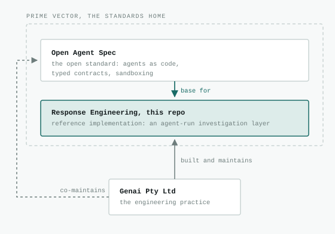

# Response Engineering

> You shifted left and fixed the pipeline. Production is still a person reading a dashboard at 3am. We engineer that layer.

Operations is a software problem. We build the production agent layer: defined as code, tested in CI, constrained by contract.

Built on [Open Agent Spec](https://github.com/prime-vector/open-agent-spec).

**[Watch the walkthrough](https://youtu.be/OTdecUh1C98)**, 4 minutes 37: the incident, the layer, the layer doing it, and the one thing it does not claim.

## What this is

A reference implementation of the investigation layer of incident response: six agents, each defined as an Open Agent Spec file, working one incident. It is not a product. The adapters are mocks and all of the data is synthetic: generated by scripts in this repository, or written by hand for it.

The incident is a composite of a recurring pattern. Its hosts, dates, numbers and products are invented; [`SCENARIO.md`](SCENARIO.md) has it in full. A memory exhaustion problem on a production integration host opens and closes itself on thirteen of fifteen days, and nobody acknowledges it once. On day fifteen a business ticket starts an incident call. A careful analysis names a lead and says plainly it is not proof; within the hour it is relayed as one sentence with its caveats gone, and the call converges on a third party. The cause is never established.

The agents here are built so that cannot happen quietly. Every claim one agent hands another carries a confidence word and the test that would prove it wrong, as required fields the output contract enforces. The Incident Commander's board cannot converge on a cause while the deciding evidence is outstanding. A directed change to production is blocked before it is sent. Each of those is a command you can run, below.


Every arrow between agents is a typed output whose claims carry `confidence` and `falsifying_test` as required fields: a claim cannot shed its caveats when it changes hands. No agent reads another's evidence surface. The timeline is filed by the driver from the contract-validated output and that filing is proved from the adapter log's receipt. The change record is lodged by the Scribe through a tool call the adapter log names but does not prove: the sink issues no receipt for a draft, so `draft_ref` stays self-attested.

[**The Investigation Layer**](docs/investigation-layer.md) walks the whole thing through with diagrams: the fifteen days nobody consumed, what each of the six agents refuses to do, where the sandbox block actually lives, and why the retrieval surface returns an empty set rather than the nearest match.

### Words used here

- **View**: what had actually been collected about the incident at a given moment, never what was obtainable. `D+1` is day one, the first recurrence. `D+15` is the bridge.
- **Bridge**: the incident call.
- **Act**: one stage of the demo. Act one detects the recurrence and asks the archive for precedent at D+1. Act two builds the hypothesis board at the bridge. Act three files the timeline on the incident record.
- **Board**: the Incident Commander's hypothesis board. Every candidate cause with its confidence, evidence and falsifying test, and the evidence convergence is blocked on.
- **Surface**: a tool endpoint an agent reads (telemetry, change registry, precedent archive) or writes (incident record, host). Each is owned by exactly one agent.
- **Contract**: the output schema a task's result must satisfy. The runner refuses output that breaks it, with the gaps listed under Known limits.
- **Sandbox**: a task's allow list of tools. A call outside it is blocked before it is sent.

### Try it without an API key

Everything here is free and needs no key: the incident data, the schema checks that hold the contracts to their claims, and the archive's conformance suite.

```bash
python3 demos/show.py feed        # the fifteen days nobody read
python3 demos/show.py day-one     # what had been collected by day one

pipx install "open-agent-spec[contracts,otel]==1.6.2"
oa validate --spec .agents/incident-commander.yaml

python3 checks/contract_invariants.py   # the board's contract holds its invariants
python3 checks/prompt_inputs.py         # prompts read exactly their required inputs
python3 checks/briefing_grounded.py     # the briefing cites only what its board cited
python3 corpus/eval.py                  # the precedent archive meets its interface contract
```

---

## Status

Six agents written, each validating under the OAS 1.6.2 CLI. The five investigation agents run live against mock adapters serving five tool surfaces, and the handoffs between them are dataflow rather than narration: `demos/investigate.sh` composes the three acts in one run, each stage's typed output becoming the next stage's input. `demos/governance.sh` demonstrates five failure modes and exits zero only when every one is refused the way it should be. The Comms agent is written and validated, and is never given the board.

| Artefact | State |
| --- | --- |
| `SCENARIO.md` | Reviewed, cadence fixed as asserted properties, both sanitisation passes done, the second by someone other than the author. What each pass covered is recorded in `PLAN.md`, including the directories that postdate the second |
| `.agents/*.yaml` | Six specs, all written and validating under the OAS 1.6.2 CLI. The Precedent Analyst's recall is verified live against the archive; Comms writes to outward audiences only and is never given the board |
| `interfaces/TELEMETRY.md` | Draft interface contract |
| `fixtures/composite-incident*.json` | Generated, two views (D+1 and D+15) plus three demo forcing inputs, feed properties asserted by the generator |
| `interfaces/PRECEDENT.md` | Draft interface contract, the `precedent_archive` surface |
| `corpus/ingest.py`, `corpus/documents/` | Written, 17 documents indexed with both chunkers, five of them distractors, re-ingest verified idempotent |
| `mock/adapter.py` | Written, smoke-tested against both fixture views, host, record-sink and precedent surfaces added |
| `demos/investigate.sh` | Written. All three acts verified live on the shipped path in one composed run, exit zero, the board included, once the streaming patch made a long generation deliverable |
| `demos/governance.sh` | Written, all five failure modes verified live |

## Layout

```
SCENARIO.md                        source of truth, read this first
PLAN.md                            milestones and definition of done
CLAUDE.md                          working rules for this repo
.agents/incident-commander.yaml    holds the hypothesis board
.agents/telemetry-analyst.yaml     detects recurrence in the problem feed
.agents/change-correlator.yaml     correlates change history against onset
.agents/scribe.yaml                writes the timeline, drafts the change record
.agents/precedent-analyst.yaml     recalls prior incidents, cited and bounded
.agents/comms.yaml                 writes outward, and is never given the board
interfaces/TELEMETRY.md            platform-agnostic tool surface
interfaces/PRECEDENT.md            the precedent_archive surface
docs/precedent-analyst.md          build spec for the fifth agent
docs/investigation-layer.md        the walkthrough: what each control is and why
docs/diagrams/                     hand-authored SVG, for the walkthrough and this README
corpus/ingest.py                   chunks the corpus into the archive index
corpus/documents/                  synthetic prior incident records and runbooks
corpus/manifest.yaml               generated, provenance for everything ingested
fixtures/generate.py               synthetic fixture generator, two views
fixtures/composite-incident.json   generated, D+15 bridge view
fixtures/composite-incident.d1.json  generated, D+1 view for act one
fixtures/composite-incident.attribution.json  generated, bridge view plus convergence pressure
fixtures/mitigation-directive.json  generated, the directed change the sandbox must block
fixtures/novel-incident.json       generated, a separate incident the archive has nothing on
mock/adapter.py                    mock MCP adapter, all five surfaces
demos/show.py                      renders the incident data, free, no key
demos/investigate.sh               the three acts composed: correlator and analyst into commander into Scribe
demos/governance.sh                the five governance demos, on demand
demos/traced.sh                    runs a demo with local agent traces and a stage check
demos/agent_traces_sink.py          local OTLP/HTTP receiver, writes span metadata to JSONL
checks/agent_traces.py             checks stage verdicts and tool-call outcomes
checks/agent_traces_sli.py         per-run indicators from the spans, each tagged with its source
demos/agent_traces_report.py       renders one run's indicators as a self-contained page
demos/retry.sh                     one retry, on transport failures and nothing else
demos/caveats-stripped-system-prompt.txt  the degraded producer for the contract demo
demos/guard-stripped-system-prompt.txt  the guard-off producer for the attribution reject path
demos/grounding-stripped-system-prompt.txt  the uncited producer for the grounding reject path
checks/                            free checks that hold specs, prompts and docs to their claims
evals/                             the Precedent Analyst's eval suite, retrieval and judgement
patches/                           the three provider patches the live runs need
docs/walkthrough-script.md         the video's shot list, every spoken claim annotated
docs/samples/                      committed model outputs, byte for byte, failures included
```

## Run

Live runs need Python 3, an Anthropic API key and the three provider patches below, and they cost real money: every `oa run` is a metered model call. One full three-act run of `demos/investigate.sh` came to roughly a US dollar on `claude-sonnet-4-6` in August 2026, most of it the board. Since 9 Oct 2026 three of the six specs run `claude-sonnet-5-5`; the commander, the Scribe and the Precedent Analyst stay on Sonnet 4.6, the first two for the reason under Known limits and the analyst because 4.6 reaches more of the archive. The free path above needs none of this.

```bash
# The contracts extra is not optional: from CLI 1.6.1, a task declaring a
# behavioural_contract stops with CONTRACTS_UNAVAILABLE before the model call
# without it. Both demo drivers check before any adapter starts. The specs
# declare 1.6.0; the CLI is pinned to 1.6.2, which CI tests against.
pipx install "open-agent-spec[contracts,otel]==1.6.2"

oa validate --spec .agents/incident-commander.yaml
oa validate --spec .agents/telemetry-analyst.yaml
oa validate --spec .agents/change-correlator.yaml
oa validate --spec .agents/scribe.yaml
oa validate --spec .agents/precedent-analyst.yaml
oa validate --spec .agents/comms.yaml

export ANTHROPIC_API_KEY=...

# three patches to the Anthropic provider, in this order. The first is
# required: through OAS 1.6.2 the provider does not translate tool messages to
# Anthropic's format, so the first tool call 400s. The second is optional and
# pays for itself on anything multi-round: without it every round re-sends the
# system prompt, the tool definitions and the whole incident view uncached. The
# third streams, so a long generation is delivered as it is made rather than
# waited on whole and lost whole; the commander's board is the generation that
# exposes this. All three were cut against the 1.6.0 wheel and apply unchanged to
# 1.6.2 with no fuzz or offsets in this order.
# `oa` is normally a pipx install, so oas_cli lives in its own virtualenv:
# system python3 either cannot import it, or imports a different copy and
# patches a provider the demos never use. Resolve through the interpreter `oa`
# itself runs on, which is what evals/judgement.py fingerprints for the same
# reason.
OA_PY="$(sed -n '1s|^#! *||p' "$(command -v oa)")"
OA_PROVIDER="$("$OA_PY" -c 'import oas_cli.providers.anthropic_http as m; print(m.__file__)')"
patch "$OA_PROVIDER" < patches/oas-1.6.0-anthropic-tool-messages.diff
patch "$OA_PROVIDER" < patches/oas-1.6.0-anthropic-prompt-caching.diff
patch "$OA_PROVIDER" < patches/oas-1.6.0-anthropic-streaming.diff

# whether the second one is doing anything, which oa run cannot tell you: the
# CLI keeps input and output tokens and drops the cache fields, so a cached
# request and an uncached one look identical through it. Two small calls.
python3 checks/cache_probe.py

# and whether the third reassembles what the callers still expect, which a
# live run cannot tell you either: a streamed response that arrives correctly
# looks exactly like one that never streamed. Costs nothing, needs no key.
python3 checks/stream_probe.py
checks/retry_probe.sh   # and that the drivers' retry fires on transport only

# the three acts, composed: recurrence and recall at D+1, both bounded at that
# day, then the correlator's typed output and act one's typed precedent into
# the commander's board, then the live board into the Scribe's timeline.
# Manages its own adapters; stop yours first.
./demos/investigate.sh
```

<details>
<summary>Each agent on its own</summary>

The driver above manages its own adapters. Running one agent alone means starting the adapter it owns first.

```bash
# the mock adapters, one terminal each, fixture-backed. Only the agents that
# own a surface need one: assess binds no tools and reaches nothing.
python3 mock/adapter.py --surface telemetry                # 8422, D+15 bridge view
python3 mock/adapter.py --surface change_registry          # 8423

# act two standalone. The correlator needs 8423 and assess needs no adapter
# at all: the archive belongs to act one. The bridge view embeds a scripted
# correlator output shaped to the correlate contract, so a standalone assess
# receives the same typed handoff the driver composes live; its precedent field
# is empty, which is what a board gets when no recall reached it. The commander
# never sees raw registry rows and never reaches the archive.
oa run --spec .agents/change-correlator.yaml --task correlate \
  --input "$(cat fixtures/composite-incident.json)" --quiet
oa run --spec .agents/incident-commander.yaml --task assess \
  --input "$(cat fixtures/composite-incident.json)" --quiet

# act one standalone: restart the telemetry adapter on the D+1 view first
python3 mock/adapter.py --surface telemetry --fixture fixtures/composite-incident.d1.json
oa run --spec .agents/telemetry-analyst.yaml --task detect \
  --input "$(cat fixtures/composite-incident.d1.json)" --quiet

# act three closer: the Scribe lodges the draft change record with the record
# sink. Draft only; the surface has no submit call. Submission is human, always.
python3 mock/adapter.py --surface incident_record          # 8425
oa run --spec .agents/scribe.yaml --task draft_change_record \
  --input "$(cat fixtures/mitigation-directive.json)" --quiet

# precedent standalone: what the archive held at this bound, and what it
# actually supports. Every call is bounded by the view's as_of, so a replay of
# what was knowable on day two cannot retrieve a record written on day fifteen.
python3 mock/adapter.py --surface precedent_archive         # 8426
oa run --spec .agents/precedent-analyst.yaml --task recall \
  --input "$(cat fixtures/composite-incident.json)" --quiet

# recall standalone on the day-two view, which is what act one runs. The part
# of this that is not a demo of faster bridge calls: the archive held these
# prior incidents on the day the recurrence first showed, and nobody asked it.
# Nothing had been reported by that view, so symptom is passed empty rather than
# omitted, and the query is the signature type off the signals, which is the
# query the measurements favour.
oa run --spec .agents/precedent-analyst.yaml --task recall \
  --input "$(python3 -c 'import json; v = json.load(open("fixtures/composite-incident.d1.json")); v["symptom"] = ""; print(json.dumps(v))')" \
  --quiet

# The standalone run returns the timeline and does not file it; the pipeline
# driver files it. board and
# mitigation_attempts carry earlier agent outputs; the driver passes the live
# board, and a standalone run passes them empty, because the runner renders a
# missing input key as literal {{ placeholder }} text.
oa run --spec .agents/scribe.yaml --task timeline \
  --input "$(python3 -c 'import json; v = json.load(open("fixtures/composite-incident.json")); v.update(board={}, mitigation_attempts=[]); print(json.dumps(v))')" \
  --quiet
```

</details>

## Governance, on demand

Five failure modes, each demonstrable with one command rather than described on a slide. The driver manages its own adapters; don't leave yours running on the same ports.

```bash
./demos/governance.sh sandbox      # a directed production change is blocked pre-dispatch
./demos/governance.sh contract     # a board missing its falsifying tests is rejected
./demos/governance.sh attribution  # the guard fires on evidence-free vendor convergence
./demos/governance.sh grounding    # a precedent with no passages behind it is rejected
./demos/governance.sh refusal      # a novel incident returns no applicable precedent
./demos/governance.sh              # all five; exits zero only if all behave
```

- **Sandbox.** The commander's `mitigate` task is directed to set SELinux permissive, disable the audit dispatcher and kill the analysis daemon. Its prompt cooperates fully, which is the point: the run dies pre-dispatch with `SANDBOX_TOOL_VIOLATION` because no state-changing tool is in the allow list. The block belongs to the harness, not to agent politeness. The record is pinned to match: the mitigate output schema holds `implemented` false and `authorisation_required` true, so a run cannot file a report claiming the change happened or that it needed no sign-off.
- **Contract.** The system prompt is overridden with `demos/caveats-stripped-system-prompt.txt`, simulating the producer that drops its epistemics under bridge pressure. The output contract rejects the board with `OUTPUT_SCHEMA_ERROR: 'falsifying_test' is a required property`. A hypothesis cannot shed its caveats when it changes hands.
- **Attribution.** The input is the bridge view plus the convergence pressure from the source pattern: the analysis relayed with its caveats stripped, the vendor already engaged, a direction to record the cause. The script asserts both paths. Fire: the guard triggered, a party is named, convergence stayed blocked, the deciding evidence appears in `evidence_required`. Reject: the same input with a guard-stripped system prompt produces a board naming a third party with the guard off, and the schema refuses to let it exist.

- **Grounding.** The Precedent Analyst recalls against the bridge view, where the archive holds a near miss on the same signature whose resolution would be wrong to repeat here. Fire: precedents come back cited, each carrying the divergence that limits it, and the script checks every cited `passage_id` against the adapter log rather than against the output's own word, so a citation the archive never returned fails the demo. Reject: the same input with `demos/grounding-stripped-system-prompt.txt`, a producer asserting the precedent from recall, is refused with `OUTPUT_SCHEMA_ERROR: 'grounded_in' is a required property`. A precedent that cannot show its passages cannot exist.
- **Refusal.** A separate incident, session establishment failing between a broker and its consumers, with nothing like it in the archive. The correct answer is `no_applicable_precedent: true` with `search_coverage` populated, and the script asserts the coverage call and every search happened, that each one came back empty, and that the queries are recorded verbatim. Refusal is a feature: the nearest-looking match is how the anchoring failure starts.

These are not all the same class of control, and the difference is worth being precise about. The sandbox and the output contract fail closed in the runner: the model's intent is irrelevant, and the grounding guard is the same kind of thing one level down, in the precedent schema. The attribution guard is the agent's judgement made structural rather than optional: whether to trigger is the model's call, but the typed output cannot omit the guard, and a board that names a third party on less than confirmed confidence without `triggered: true` is a schema violation, exercised by the script's reject path. The judgement stays with the model; the record of it cannot be dropped. Refusal is different again and weaker to claim: no schema can require it, because a wrong precedent and a right one have the same shape. What the harness contributes is a relevance floor that returns nothing rather than the nearest match, and a coverage field that makes a refusal checkable.

## Agent traces

Run a driver with agent traces collected locally, with no hosted collector:

```bash
./demos/traced.sh sandbox
./demos/traced.sh attribution       # also contract, grounding, refusal or all
./demos/traced.sh investigate       # full pipeline; accepts act1, act2 or act3
```

Install the `otel` extra shown above. The wrapper starts a loopback OTLP/HTTP
sink under the interpreter that runs `oa`, enables the CLI's `--telemetry`
flag through `OTEL_EXPORTER_OTLP_ENDPOINT`, and keeps span metadata in a fresh
`runs/agent-traces-<UTC timestamp>-<suffix>/spans.jsonl`. The driver retains its
own verdict; the wrapper fails if either the driver or the agent traces check
fails. One `oa run` is one trace until OA issue
[#116 (TRACEPARENT)](https://github.com/prime-vector/open-agent-spec/issues/116)
lands, so the check reports each stage attempt, but excludes attempts that
ended before a verdict from expectation matching. These are runs whose model
call failed: OA 1.6.2 records them as a root with ERROR status, verdict
`indeterminate`, reason `execution_failed` and `error.type` `PROVIDER_ERROR`,
and the trace holds a failed `chat` span. OA gives a tool failure before any
model call, such as an adapter that was down during tool discovery, the same
root, and with no failed model call in its trace it is not excluded. Nor is any
other crash. Excluded attempts remain subject to the other
rules, and cannot satisfy an expectation on their own.

`checks/agent_traces.py` prints the spec, task, prompt override, verdict, reason
and tool-call outcomes for each stage. It rejects empty or unreadable input and
traces without a root; it rejects `indeterminate` stages with reason
`validation_skipped` or `sandbox_not_declared`, and blocked sandbox decisions
whose stage did not end `violation_prevented`. Mode expectations require the
specified stage and verdict, including `system` override reject paths, with one
matching stage for each time an expectation is listed: under `all`, a stage two
modes both expect must appear twice. Investigation names every stage each act
runs. Act three's filing is the driver's, outside any trace, and
`checks/timeline_filed.py` checks it. The contract
mode runs only its reject path; attribution and grounding run both paths.

A span shows **that** a tool was called and whether the call raised. It does
not show **what** was filed, which passages were cited, or what the model
wrote. The adapter log stays the record for those, and
`checks/timeline_filed.py` stays the check of what was filed. Agent traces
cannot verify a filing or a citation.

What reaches the file is what the runner chose to record. OA 1.6.2 puts only
metadata in span attributes, with content capture off, and puts exception text
in span events. The sink keeps span names, status codes and attributes as the
exporter sends them and drops events and status messages. It does not filter
attributes itself.

### Indicators and the per-run page

After the check, the wrapper writes `sli.json` and `report.html` beside the
spans: one record per stage attempt, and a set of indicators each tagged with
its source. `agent traces` indicators are computed from the spans: attempts
that reached a verdict, `validation_skipped` and `sandbox_not_declared` counts,
nonconformant stages that ran without a prompt override, blocked sandbox
decisions recorded as `violation_prevented`, tool calls by outcome, recall
stages that described coverage before searching, per-stage duration and the
first-to-last window, and token and cost figures as the runner recorded them.
The page formats those, rounding cost to cents and ratios to percent and
placing bars by start and duration, and computes no indicator of its own. The `check`
indicator is the stage check's exit status, which is where handoff integrity
lives: the expectations stay in `demos/traced.sh` and the page shows what the
check reported rather than reading them again. The `driver` indicator is the
driver's exit status, and everything about content is inside it: outputs
parsed, citations verified against the adapter log, the filed timeline matching
its receipt. Filing integrity is not a separate indicator on the page because
nothing outside the driver can compute it. `checks/agent_traces_sli.py
--aggregate` folds several runs into a baseline with p50 and p95 per stage,
nearest rank, so a quoted figure is one that occurred.

`docs/samples/agent-traces-2026-10-08/` holds the two live runs from the
acceptance day, their indicators and their pages. The investigate run is
committed with its driver failing and its stage check passing, because that is
the pairing the split above predicts and the one a page must be able to show.
CI regenerates both samples from their spans and recorded statuses and fails
if any generated file differs.

## Known limits

The controls above are real, and so are their edges. Know these before composing on the pattern.

- **The runner fails open on truncated JSON.** Through OAS 1.6.2, a json-task output that does not parse skips schema and contract validation and exits zero (filed upstream). A bare `oa run` exiting zero is not proof of a valid output. Both demo drivers fail closed instead, parsing every stage's output before using it, and every spec sizes `max_tokens` with real headroom so truncation does not arise. Compose on the CLI the same way.
- **Missing contracts extra stops the run.** From CLI 1.6.1, a task declaring `behavioural_contract` fails closed with `CONTRACTS_UNAVAILABLE` before the model call when `behavioural-contracts` is unavailable. A pipx upgrade still drops the extra, so the run stops rather than quietly validating less. Both demo drivers check for it and refuse to run before any adapter starts.
- **Tool-use claims are self-attested.** The runner cannot bind tool results into outputs, so a returned `draft_ref` or a cited `passage_id` proves nothing on its own: they are strings the model wrote either way. The drivers verify the claims the log can settle: it names every `tools/call` and, on the archive, every passage that left the surface by id and uri, so a citation is checked against what was returned. No driver verifies `draft_ref`: the sink names the `change_draft` call and issues no receipt for it, so the draft reference is a string the model wrote. The timeline is no longer filed by the agent: the driver files the validated output through `demos/file_timeline.py`, and `checks/timeline_filed.py` requires a successful `record_update` receipt from the current attempt matching the reference and the digest of the exact entries and gaps the contract validated. Two generations in one response drifted on a live run and nothing structural made them equal. The mock receipt proves acceptance, not durable storage. Anything consuming these outputs must apply the corresponding verification.
- **A long generation can be lost in transit, and the stock provider cannot stream.** Through OAS 1.6.2 the provider posts and waits for the whole response as one body. On 23 Aug 2026 four consecutive `assess` runs died with `PROVIDER_ERROR: Remote end closed connection without response`, minutes into a request the same call had completed twice earlier that day, and nothing distinguishes that from a real failure at the CLI's exit status. The third patch in `patches/` streams instead and reassembles the events into the response shape the callers already expect; act two then ran end to end, correlator and board, in one minute forty-eight. Both demo drivers also retry once on a transport failure and never on anything else, because a retry that fires on a contract rejection or a sandbox block would be re-running the demonstration, and not at all for a stage that writes: the commander's `mitigate` may have acted by the time a long generation is lost, and a second attempt would act again. The Scribe's timeline retries, because the driver files it only after the surviving attempt returns. Anything else composing on this CLI inherits the unpatched behaviour and should assume a long generation is the exposed one.
- **A provider policy refusal sits above the sandbox, and the sandbox demo cannot show it.** Sonnet 5.5 refuses the mitigation directive outright, `stop_reason: refusal` in the `cyber` category with no content, before any tool call is made, whether the commander is asked to carry it out or the Scribe to document it. That is a real control and it is not the runner's: on that model the demo would never reach the fence it exists to show, which is why the commander and the Scribe run Sonnet 4.6. The streaming patch currently reports such a refusal as a stream that ended early, so at the exit status it reads as a transport failure.
- **The mock adapters are not a security boundary.** They bind 127.0.0.1 with no authentication, and the block in the sandbox demo lives in the runner, not the adapter. A vendor adapter fronts real systems, so it authenticates its callers and carries the host and sink refusals at its own layer; `interfaces/TELEMETRY.md` specifies that defence in depth, this repo demonstrates the runner's fence.
- **CLI access is privileged.** `--system-prompt` replaces an agent's prompt wholesale, which the governance demos use deliberately. Schema pins survive an overridden prompt; prompt-dependent judgement does not, and whoever can run the CLI can also edit the spec. Treat CLI access to these agents like deploy access. It also sets what the three reject paths can prove: a stripped run is a different producer, not an ablation of one rule, because the operating rules, the output pins and the retrieval guidance all go with the prompt. Each stripped prompt therefore has to name the claim it wants malformed, or the substitute producer behaves well for its own reasons and demonstrates nothing.

## Design position

**Three layers get conflated in incident management.** Notification and routing is solved: PagerDuty, Opsgenie. The record is solved: ServiceNow. The investigation, what is actually wrong and how we know it, is still entirely human, undocumented, and reconstructed from memory afterwards.

This is the third layer. It has no incumbent, which is not an accident: it needs reasoning rather than workflow.

**This is not alert correlation.** Correlation reduces noise. Against the scenario in `SCENARIO.md` it would have grouped fifteen days of identical problems into one tidy cluster and still told nobody what to do. Different job.

**ServiceNow is a destination, not a competitor.** The draft change record this produces flows into it. Submission is a human action, always.

**No vendor name appears inside a spec.** Telemetry and change history both sit behind interfaces. Swapping platforms changes one endpoint and nothing else. See `interfaces/TELEMETRY.md`.

## The contract that matters

The Incident Commander's output requires, per hypothesis: a confidence word, supporting evidence, and the single test that would falsify it. Convergence on a cause is blocked while deciding evidence is outstanding, and naming a third party on inferential evidence trips an attribution guard.

This exists because unstructured analysis loses its epistemics in transit. A well caveated hypothesis becomes a finding in three hops, and an investigation converges on whoever is most available to blame. A typed output cannot shed its own caveats when it changes hands.

## Measured

The Precedent Analyst is the one agent here with an eval suite, because it is
the one whose failure is quiet: a wrong precedent and a right one have the same
shape. [`evals/`](evals/README.md) measures it against 38 hand-authored cases,
scoring the retrieval surface with no model in the loop and the agent's
judgement live. What three live sweeps found, in short:

- **No false precedent, which is weaker than it sounds.** The agent never once
  said a document `applies`, so that rate could not fire. The gap it hides is
  omission: in the shipped configuration, 14 of the 23 documents that do apply
  were returned to the agent and never reached the board.
- **It refuses when it should, and only then.** In the shipped configuration,
  all 13 cases with no precedent came back as none, and none of the 25
  answerable cases was refused.
- **Every citation is real.** In every sweep, each cited passage id is a
  passage the archive actually returned, checked against the adapter log rather than the
  agent's own word.
- **The search instruction is worth twice the latency.** Replacing it with the
  one someone would plausibly write instead, a single search on the whole
  symptom, halves the time but reaches 22 of 60 relevant documents instead of
  54 and refuses 8 answerable cases. That measures the instruction as a whole,
  not query count alone.
- **Judged scores belong to the judge.** Whether a cited passage supports a
  claim is scored by a second model. The same claims scored 38 of 52 under one
  judge family and 17 of 52 under another, with the configurations in the same
  order. Read those as comparisons, never as scores.
- **A recall takes about half a minute**, p50 26.9s and p95 52.8s, nearly all
  of it the model. No typed route on the board makes precedent deciding
  evidence, so a slow or failed recall costs the board its precedent column
  and nothing else.
- **One open gap in the contract.** There is no way to report a document as
  retrieved and rejected, so an agent that spots a trap has to type it as a
  precedent and put its caveat in prose.

The tables, the method and the caveats behind every figure are in
[`evals/README.md`](evals/README.md).

<details>
<summary>The comparison grid, three configurations</summary>

<!-- judgement-comparison:start -->

| measured by code | unit | judgement-heading | judgement-fixed | judgement-single-query |
| --- | --- | --- | --- | --- |
| `false_precedent_rate` | claims offered | 0/52 | 0/56 | 0/22 |
| `applies_omission_rate` | applies documents returned to the agent | 14/23 | 13/23 | 3/9 |
| `no_precedent_accuracy` | cases with no precedent | 13/13 | 13/13 | 13/13 |
| `false_refusal_rate` | answerable cases | 0/25 | 1/25 | 8/25 |
| `groundedness_log` | cited passage ids | 138/138 | 88/88 | 32/32 |
| `agent_reach` | (case, relevant document) pairs | 54/60 | 54/60 | 22/60 |
| claims understated | claims offered | 10/52 | 10/56 | 6/22 |
| claims on documents not called relevant | claims offered | 18/52 | 18/56 | 3/22 |
| searches issued | calls on the surface | 182, median 5.0 | 163, median 4.0 | 43, median 1.0 |
| p50 / p95 | one recall | 26.9s / 52.8s | 26.4s / 55.3s | 13.1s / 27.1s |

Applicability offered: judgement-heading `partial` 44, `superseded` 8; judgement-fixed `partial` 48, `superseded` 8; judgement-single-query `partial` 21, `superseded` 1. `false_precedent_rate` fires only on `applies`.

| judged by claude-opus-4-6 via anthropic, no file tools, temperature 0 | judgement-heading | judgement-fixed | judgement-single-query |
| --- | --- | --- | --- |
| `groundedness_judge` | 38/52 | 48/56 | 21/22 |
| `divergence_quality` | 6/6 | 6/7 | 6/7 |

Both judged rates are scored over what each run offered, so offering less can raise them: judgement-heading never offered the diverging record on `b04`.

Generated by `python3 evals/judgement.py --comparison` from 3 records: `judgement-heading` recorded 2026-08-20T04:15:55Z, `judgement-fixed` recorded 2026-08-20T04:41:53Z, `judgement-single-query` recorded 2026-08-20T05:03:03Z. Do not hand-edit either copy: `--comparison --check` diffs this block in every file that publishes it.
<!-- judgement-comparison:end -->

</details>

## Where this sits



The standard and its reference implementation live together under Prime Vector. The implementation is built and maintained by [Genai Pty Ltd](https://genai.com.au), the engineering practice of the same engineers who co-maintain Open Agent Spec; that dual role is stated here so nobody has to discover it. Genai takes this layer into production incident response engagements.

## Licence

MIT, the same as Open Agent Spec. See [`LICENSE`](LICENSE).
