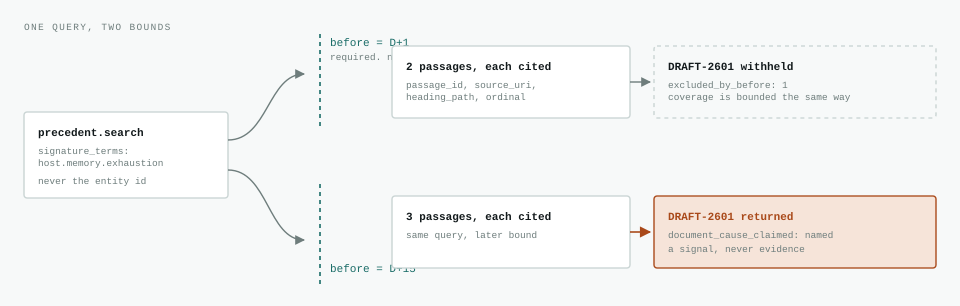
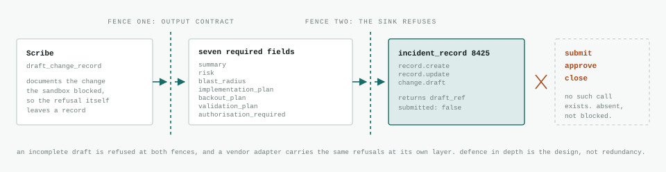

# The Investigation Layer

> Notification is solved. The record is solved. What is actually wrong, and how
> we know it, is still a person reading a dashboard at 3am.

This is a walkthrough of what this repository builds and why each control is
shaped the way it is. `SCENARIO.md` is the source of truth for the incident it
works from; this document is the argument that incident supports.

Response Engineering is six agents with typed contracts. MCP is how they reach
evidence. Retrieval is how they reach memory. Neither is the point on its own:
the point is what a standard seam lets you enforce across it.

The scenario is a composite of a recurring pattern. It is not a client
incident, not a case study, and not attributable to anyone. Host names, dates,
numbers and vendors are invented. No third party is named in a causal role,
here or anywhere in this repository, because naming a vendor as a cause without
direct evidence is the exact failure this work exists to criticise.

---

## Act zero: what the tooling got right, and what nobody consumed

A production integration host holds 23 GiB of 32 GiB resident at steady state.
Normal for months, on no risk register, attached to no alert, because at steady
state nothing is wrong. Then a new process arrives with an appetite, and the
headroom is gone.

The observability platform noticed. It kept noticing, correctly, for fifteen
days.


*Detection ran. Consumption did not.* The change eight days before onset and the
correlation that would surface it were both sitting there the entire time. The
correlation was finally run two hours and twenty one minutes into the bridge
call. The cause was never established; it was made to stop mattering.

**Detection was never the problem.** Fifteen days of correct, specific,
automated detection went into an empty room.

---

## The layer: six agents, six contracts, one job each

This is not one agent with many tools. It is six specs, each declared as code,
each validated in CI, each owning one narrow job. The rule about surfaces is
that every surface has exactly one owner, not that every agent has one: the
Incident Commander and Comms own none, which is the point of both. That
decomposition is what makes the rest possible: a single agent holding every
capability has no seam to put a contract on.

Read the roster as six refusals as much as six capabilities. What each agent
will *not* do is the load-bearing half.

| Agent | Surface | Task | Emits | Will not |
| --- | --- | --- | --- | --- |
| **Telemetry Analyst** | `telemetry` 8422 | `detect` | `recurrence_detected`, `recurrences[]` with `occurrence_count`, `auto_closed_count`, `acknowledged_count`, `standing_conditions_implicated` | Propose a cause. Zero acknowledgements is the finding that matters most. |
| **Change Correlator** | `change_registry` 8423 | `correlate` | `onset_at`, `correlation_found`, `correlations[]`, `registry_caveats` | Name a cause. Carries the caveat that self-updating agents do not appear in package history with a current timestamp, so absence from the list is not absence of change. |
| **Precedent Analyst** | `precedent_archive` 8426 | `recall` | `no_applicable_precedent`, `search_coverage`, `precedents[]` with `grounded_in`, `divergence`, `applicability` | Return the nearest-looking match. No applicable precedent, with coverage populated, is a complete answer. |
| **Incident Commander** | none | `assess`, `brief`, `mitigate` | `hypotheses[]` with `statement`, `confidence`, `supporting_evidence`, `contradicting_evidence`, `falsifying_test`, `rules_in`; `blocking_evidence`; `attribution_guard`; `convergence_allowed` | Converge while deciding evidence is outstanding. A hypothesis omitted from the board has no typed route downstream: the briefing renders one entry per hypothesis, held to that by `checks/briefing_grounded.py`, and the Scribe files from this board. Prose is not closed, so a briefing sentence can still assert what no hypothesis holds. |
| **Scribe** | `incident_record` 8425 | `timeline`, `draft_change_record` | `entries[]`, `gaps[]`, `blast_radius`, `backout_plan`, `validation_plan`, `cause_status`, `submitted: false` | Submit, approve or close. Everything it writes is a draft or an append, and the sink has no call that would let it do otherwise. |
| **Comms** | none | `update` | `headline`, `impact_statement`, `what_is_being_done`, `cause_status`, `next_update_at` | State a cause, or name a third party at all. It is given no evidence, no hypotheses and no board, so a hypothesis has no field to arrive in. Prose still travels: this narrows, it does not fence. |

### The confidence vocabulary

`speculative` &rsaquo; `plausible` &rsaquo; `likely` &rsaquo; `supported` &rsaquo; `confirmed`

Five words, fixed, and the same five wherever a claim is carried: an enum in every spec that carries one, held to the commander board's values and order by `checks/contract_invariants.py`, which fails rather than skips on any schema form it cannot read through, because a claim keeps its epistemics only while the agent receiving it can express the word the agent sending it used. Comms is the exception and the exception is the point: it reports impact to people outside the response, carries no hypothesis, and states `cause_status` instead. Investigator epistemics in a customer update would be the wrong artefact. Nothing reaches
**confirmed** without direct evidence in the evidence array. Inference is never
confirmation, and a hypothesis with no falsifying test is an opinion that must
be labelled as one.

### How the five are meant to compose, and what runs today

One command runs the lot. Each stage's typed output becomes the next stage's
input, and the driver parses every stage before using it rather than trusting
an exit code.

Comms is the one agent that does not appear in the acts below. It writes
outward, to people who are not on the bridge, and the investigation does not
wait on it. It is in the table because the boundary is the point: the briefing
that goes to the bridge and the update that goes to a customer are different
artefacts derived from different inputs, and only one of them is allowed near
a hypothesis.

![Three acts. Act one at D+1 runs the Telemetry Analyst detect task and the Precedent Analyst recall task against the near-empty day one view, both bounded at that day, so the working note written later in the incident is out of reach. Act two at the D+15 bridge runs the Change Correlator, whose correlation feeds the Incident Commander assess task alongside act one's typed precedent. Act three is the directed change: the commander's mitigate task blocked pre-dispatch and the Scribe drafting the change record, which run from the governance driver and a standalone invocation, and the Scribe filing the timeline from the live board, which is what the pipeline's own third act runs.](diagrams/three-acts.svg)

*Do not open at the bridge.* Opening at the bridge sells two hours of saved call
time. Opening at D+1 sells fifteen days of degraded production and an
unnecessary vendor escalation. Act one is a separate invocation against the
near-empty D+1 view, which is the predictive half and the part nobody else
demonstrates.

> **Current state.** `demos/investigate.sh` composes three acts across five
> agents. Act one asks the archive as it stood that day, act two asks the
> change registry, and both typed outputs reach the commander. The board drawn
> from act one's recall cites `INC-2411` three times, `INC-2419` three times and
> the memory-pressure runbook once, across two of its four hypotheses, with four
> items outstanding and convergence blocked. That board did not come through the
> CLI on the day it was first drawn: `docs/precedent-analyst.md` records the
> transport failure and the streaming patch that closed it, and the README
> carries both as a known limit, since anything composing on an unpatched CLI
> still inherits the failure. The composed pipeline now produces the board
> through `oa run`. Three things
> the diagram does not claim. Act one is a separate invocation and its findings
> are not composed into the board, which reads the bridge view's own signals,
> and the diagrams that draw that arrow now mark it rather than presenting it
> as a handoff. Act three spans two drivers: the blocked change is
> `demos/governance.sh sandbox` and the draft record a standalone run, which is
> why the connector between them is dashed. And recall runs at the day-one
> bound, next to detection, where the working note dated inside this incident's
> window does not exist yet: rejecting it is a different demonstration and has
> its own mode in `demos/governance.sh`.

---

## Seam one: MCP, how the layer reaches evidence

MCP is a standard plug between a model and a system. That much is plumbing.
What matters is what the standard plug lets you enforce: each surface has
exactly one agent that owns it, and every handoff between agents is a typed
object rather than a hallway conversation.

No vendor name appears inside a spec. The agent asks for the list of problems
on an entity; which platform answers is the adapter's problem. Swap the
platform, change one endpoint, change no agent. See `interfaces/TELEMETRY.md`
and `interfaces/PRECEDENT.md`.

![Evidence surfaces reached over MCP, each owned by exactly one agent. The Telemetry Analyst, Change Correlator and Precedent Analyst each read one surface, and the correlator's correlation and the analyst's precedent reach the Incident Commander as typed input while the Telemetry Analyst's findings are marked as the handoff the pipeline does not compose, whose live board goes to the Scribe, which writes to the incident record sink through a tool call. A crossed arc shows that raw registry rows never reach the commander.](diagrams/mcp-surfaces.svg)

*One agent, one surface; every arrow between agents is a typed object.* The
bridge view holds the raw change rows, and the commander never sees them: what
it knows about the D-8 deployment is whatever the correlator was willing to put
its name to, caveats attached. The sink is write-shaped but has no submit,
approve or close call, so submission stays a human action and the capability to
bypass that is structurally absent rather than merely blocked.

### Where the block actually lives

Anyone can build an agent that declines politely. The question a responder
should ask is where the refusal is implemented, because a refusal that depends
on the model's mood is not a control. In the sandbox demo the commander is
directed to set SELinux permissive, disable the audit dispatcher and kill the
analysis daemon. Its prompt cooperates fully. That is the point.


*The block belongs to the harness, not to agent politeness.* The output schema
is pinned alongside it, so a run cannot file a report claiming the change
happened or that it needed no sign off. Anything that alters production state,
changes a security control, or is irreversible inside the incident window
carries `authorisation_required: true`. There is no configuration option that
turns that off.

| Control | Where it lives | What it survives |
| --- | --- | --- |
| Sandbox | Fails closed in the runner, before dispatch | A fully cooperative prompt. The model's intent is irrelevant. |
| Output contract | Fails closed in the runner, on validation | A system prompt rewritten to drop its caveats. |
| Attribution guard | The model's judgement, made structural | Whether to trigger is the model's call. Whether the call is recorded is not: naming a third party below confirmed confidence without `triggered: true` is a schema violation. |

---

## Seam two: the Precedent Analyst, how the layer reaches memory

An investigation layer that cannot recall what happened last time is
reconstructing from memory, which is the exact failure the whole thing exists
to fix. So the fifth agent owns an archive of prior incident records, runbook
procedures and postmortems, and hands the commander typed precedent alongside
the correlation. Not alongside the findings: `assess` has no such input, act
one's detect is a separate invocation, and the diagrams that draw that arrow
mark it for the same reason.

There is a closure worth noticing: the archive holds records in the shape the
Scribe files. The fifth agent reads what the fourth writes.

**The failure mode is not a missed precedent. It is a confident wrong one.** A
prior incident that resembles this one arrives already believed. It anchors the
board and sends the investigation down a path that feels evidenced. Missing a
precedent costs a search. Offering a wrong one costs the incident.

### How recall actually works

Recall is not one call. It is coverage, then search, then a fetch for the passages it wants in full,
then the reply, and every round spends from the same response budget. That is
why the spec sizes `max_tokens` at 16000 with a comment calling it a
correctness setting: an undersized budget here does not produce a shorter
answer, it truncates the JSON, and the runner fails open on truncated output by
skipping validation and exiting zero. Headroom is what keeps the grounding
guard switched on.


*Coverage first, and the entity id never enters the query.* A query built on the
host makes identity a retrieval feature, and the archive starts returning
records because they mention the same machine rather than because they describe
the same failure. Searching once is the other trap: a query carrying every word
of the reported symptom is mostly words that do not discriminate, so the spec
requires a separate search per distinct behaviour the evidence describes, and
every query issued goes into `queries_issued` including the ones that returned
nothing.

*And `queries_issued` is the agent's account of that, so it is not what the rule
is checked against.* The archive logs the arguments of every call it receives,
so what was actually asked is on the record beside what was actually returned.
An agent that put the host in a query and reported it stripped would pass a
check read from its own output and fail one read from the log. The same log is
what verifies the time bound below: `before` is checked per call against the
view's `as_of` rather than taken from the reply. Across the three recorded
sweeps, 388 searches carried the right bound and none carried an entity id, and
both of those are measurements rather than assurances.

### What the surface refuses on the agent's behalf



*The corpus carries a deliberate hindsight trap.* `DRAFT-2601` is dated inside
the live incident's window and names a cause that was never established. It is
the only document recent enough to catch a search that omits its time bound.
Making `before` mandatory on search *and* on coverage is what stops a replay of
what was knowable on day two quietly answering with day fifteen's rumour. An
optional hindsight control is how hindsight gets in.


*Three counts rather than one, because one cannot separate the cases an empty
result could mean.* Zero considered means the bound emptied the archive.
Considered with nothing scoring means the archive holds nothing the query
touches. Considered, scoring, none clearing is the only one that is a precedent
judgement. A refusal that nobody can check is worth exactly as much as a claim
nobody can check, which is why `coverage.describe` exists and why the refusal
path requires it populated.

The figures above are the ones `corpus/eval.py` reports for its novel-incident
case against `corpus/index.json`. They move when the corpus does.

What the surface hands an agent and what the agent does with it are measured
separately, in `evals/`: retrieval mode scores the surface with no model in the
loop, and judgement mode runs the agent live over 38 hand-authored cases. The
result table is in the README, and the finding worth carrying here is that a
clean headline can hide the failure underneath it. The agent offered no false
precedent in any arm, and in the shipped configuration 14 of the 23 documents
the ground truth says apply here were returned by the archive and never reached
the board at all.

### Three qualifiers travel with every passage

A passage arrives carrying properties of the whole document it was cut from.
The `document_` prefix is doing work: two passages carrying the same claim are
one source saying one thing twice, and named without it they read as two
records agreeing.

| Qualifier | What it means | What the agent must do with it |
| --- | --- | --- |
| `document_cause_claimed` | The prior record states a cause. | Report it as something the record claims. Never carry it into the output as this incident's cause, never repeat it as a finding, and never name a third party on the strength of it. A record of what someone concluded is not a record of what happened. |
| `record_status` | Not `filed` means a draft: unsubmitted and unreviewed. | It carries no more authority than the notes it was assembled from and cannot be the basis of a precedent claim. Nor can a record describing the incident under investigation: a working note written during this one is not precedent for it, whatever its signature. |
| `document_superseded_by` | A later change invalidated the resolution described. | Set `applicability: superseded`, cite it, and do not describe it as an option. Copy the superseding text into `divergence` verbatim: it names the standard or change that withdrew the resolution, and that name is the whole value. Without it the warning is one a reader can neither act on nor check. |

### The refusal and the claim cannot both be true

Most of the contract is required fields. This part is different: two
conditional rules that make the refusal and the claim mutually exclusive at the
schema layer, rather than leaving it to the model's judgement.


*Without the first rule a run can report the refusal and hedge underneath it.
Without the second it can deny precedent exists while listing none, which is a
refusal that will not say it is one.* Both are the sort of thing a model does
under pressure to be useful, and both are unreachable here because the schema
will not encode them.

### And then it lands on the board, in exactly one column

This is the composition claim, and it is narrower than it looks. Precedent
enters the commander's hypothesis board as supporting evidence, and no typed
route on that board turns it into deciding evidence, because precedent
describes what happened somewhere else. The prose route stays open and is
described below.

*Narrower, and structural.* Four rules in the commander's output contract, not
four instructions in its prompt: `hypotheses[].precedent_cited` is the only
field on the board a passage id may appear in; `blocking_evidence` is closed,
so the list convergence blocks on cannot carry one; `convergence_allowed` must
be false while any blocking item is `still_outstanding`, which is a required
field; and a hypothesis carrying a citation cannot be `confirmed`. That closes
the typed routes and not the prose ones, which is the honest size of the claim:
a blocking item whose description asserts a passage settled it, marked not
outstanding, converges, because the board authors the list it is held to and a
schema never sees the view behind it. Nor does it prevent a passage paraphrased
into `supporting_evidence` with no citation at all, and `demos/investigate.sh` checks the rest of it against the
adapter log rather than against the board's own word: every cited id resolves
to the document the archive returned it from, so a hypothesis naming one record
while citing a passage of another fails the demo.


*That a passage says what it says can be confirmed. That it applies here cannot
be, from where this agent sits.* So `applicability` and `confidence` are
judgements the spec requires it to argue for rather than assert, on the
commander's own five-word scale, which is what lets the claim keep its
epistemics when it changes hands. The sharpest divergence is usually in
`missing_evidence`: a prior incident settled by evidence nobody has here yet is
a prior incident that does not transfer.

---

## The record: what the Scribe writes, and the two fences it passes

In the composite, the change record was never written. The Scribe writes the
one that should have existed, and it is the only agent in the system that
writes anywhere. That makes it the one worth fencing twice.



*The gaps are as much a part of the record as the entries.* The timeline output
carries a `gaps[]` array with `how_to_obtain` and `obtainable_since` on each
one, because a timeline that omits what was never collected reads as complete
when it is not. In the composite, the audit denial log was requested twice and
never produced. That absence belongs in the record.

---

## The differentiator: a claim that cannot shed its caveats

At 18:38 the analysis was right and correctly caveated. It named the lead, said
explicitly that it was a lead and not proof, and named the one piece of
evidence that would settle it. Three hops of human retelling later, a
hypothesis was being treated as a finding and a vendor was on the call
answering for something nobody had evidence they did.


*The claim is not that the model would have been right.* The lead still gets
raised, because it was a reasonable lead. What changes is structural: when
confidence, supporting evidence and the falsifying test are required fields on
a typed output, a hypothesis cannot be quoted downstream stripped of its
caveats. Strip them anyway, and the run dies with
`OUTPUT_SCHEMA_ERROR: 'falsifying_test' is a required property`.

---

## What this claims, in descending order of confidence

**Tier 1, claim hard. Days, not weeks, to human attention.** Requires only a
process that consumes the problem feed and notices recurrence. No diagnosis, no
cleverness. The same signature auto-closing on the same entity is a signal on
day two.

**Tier 2, claim confidently. The bridge opens with change correlation already
on the board.** Package history against onset is a lookup. The bridge does not
disappear and humans still decide. It starts from evidence rather than spending
two hours assembling it.

**Tier 3, claim carefully. The hypothesis reaches the bridge with its
epistemics intact.** It arrives labelled unconfirmed, with the deciding
evidence marked blocking, so investigation does not converge on a third party
before the evidence that would exonerate them has been collected.

### And what it refuses to claim

**Not a root cause.** It was never established in the pattern this composite is
drawn from, and the demo must not invent one. The compliance agent is the
leading hypothesis. It is not a finding.

**Not autonomous remediation.** Every action that changes host state here is a
security control change and requires human authorisation.

**Not a perfect outcome.** Earlier, better evidenced and honestly bounded. Not
solved. The demo closes on the blocked state: hypothesis unresolved, deciding
evidence outstanding, here is the single command that settles it, here is what
each outcome rules in and rules out.

---

## Demonstrable, not described

```bash
./demos/investigate.sh               # the composed acts, one run

./demos/governance.sh sandbox        # a directed production change is blocked pre-dispatch
./demos/governance.sh contract       # a board missing its falsifying tests is rejected
./demos/governance.sh attribution    # the guard fires on evidence-free convergence
./demos/governance.sh grounding      # a precedent cannot be offered without its passages
./demos/governance.sh refusal        # a novel incident returns no applicable precedent
./demos/governance.sh                # all five; exits zero only if all behave
```

Attribution and grounding have both a fire path and a reject path, and the
script asserts both. Sandbox and refusal are fire only, contract is reject
only. The reject paths run with the agent's system prompt deliberately replaced
by a degraded one, which is the honest test: schema pins survive an overridden
prompt, prompt-dependent judgement does not.

See the README for setup, including the provider patch and the contracts extra
the drivers require.

---

The diagrams in `docs/diagrams/` are hand-authored SVG and are the source, not
a build artefact. Each one paints its own background and carries literal
colours rather than inheriting them: GitHub renders an SVG inside an ``,
where the page stylesheet does not reach it, so a diagram that does not paint
its own ground is unreadable on one theme or the other.
